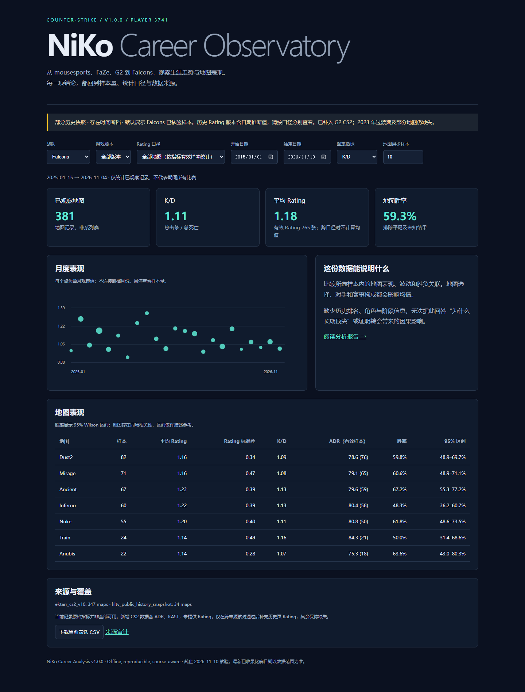

# NiKo Career Analysis

**v1.0.0 · Counter-Strike 数据分析作品**  
Python / pandas / SQLite / offline dashboard

以 Nikola “NiKo” Kovač 为核心，分析生涯阶段、地图表现与胜负关联。项目交付包含可复现数据管道、来源审计、中文分析报告和离线交互看板。

[分析报告](reports/analysis.md) · [交互看板](dashboard/index.html) · [数据来源](docs/sources.md) · [v1 发布说明](CHANGELOG.md)



## 核心发现

- **CS2 同来源样本**：G2 的 K/D 为 1.148、ADR 为 82.4（195 张地图）；Falcons 为 1.106 和 79.6（347 张）。两组时间与对手构成不同，这些数字不证明转会造成变化。
- **地图表现**：Falcons 至少 20 张观察地图的组中，Train 的总 K/D 为 1.161（24 张），为当前样本最高；样本不平衡，不代表差异显著。
- **胜负关联**：Falcons 有 Rating 的子样本中，赢图平均 1.333（154 张），输图 0.976（111 张）。这是同场关联，不能当作赛前预测效果。

完整证据、有效样本数和限制见 [报告](reports/analysis.md)。

## v1 数据范围

| 阶段 | 已接受地图 |
|---|---:|
| mousesports / CS:GO | 372 |
| FaZe / CS:GO | 799 |
| G2 / CS:GO | 283 |
| G2 / CS2 | 195 |
| Falcons / CS2 | 381 |
| **合计** | **2,030** |

日期跨度：2015-04-17 至 2026-11-04，快照核验日：2026-11-10。**本版本为部分覆盖的固定研究快照，不是完整生涯普查。** 2021–2023 补充数据较稀疏，2023 年过渡期及其他来源仍有遗漏。

旧原始数据已通过三个 CSV 的 SHA-256 比对确认来源。新 CS2 数据严格排除系列赛总计，并将 provider ID 26 与另一位 niko 区分。231 条 Rating 合并通过跨来源核对；冲突与日期歧义单独记录，未伪造缺失值。

## 直接体验

解压后打开 `index.html` 或 `dashboard/index.html`，不需联网、安装依赖或 API Key。支持战队、CS:GO/CS2、日期、Rating 口径和最小样本量筛选，以及当前结果 CSV 导出。

看板的“阅读分析报告”可打开 [HTML 报告](reports/analysis.html)。GitHub 上请阅读 [Markdown 报告](reports/analysis.md)。

## 从零复现

Python 3.11+；以下命令在仓库根目录运行。Windows PowerShell：

```powershell
python -m venv .venv
.\.venv\Scripts\python -m pip install -r requirements.lock
.\.venv\Scripts\python -m tools.build_portfolio
.\.venv\Scripts\python -m unittest discover -s checks -v
```

macOS / Linux：

```bash
python3 -m venv .venv
.venv/bin/python -m pip install -r requirements.lock
.venv/bin/python -m tools.build_portfolio
.venv/bin/python -m unittest discover -s checks -v
```

构建离线读取 `data/processed/niko_maps.csv`，输出报告、汇总 CSV、图表、SQLite 和自包含 HTML。SQLite 在本地 `database/` 自动生成，不上传。锁定依赖用于复现；`requirements.txt` 提供兼容版本范围。Jupyter 是可选交互工具，不影响构建。

可选检查（Node.js 22+）：

```bash
node checks/dashboard.cjs
```

浏览器回归测试说明见 [验证文档](docs/validation.md)。

## 分析方法

- K/D 使用总击杀 / 总死亡；Rating、ADR 使用地图等权均值，各自显示有效样本数。
- 跨 Rating 口径不计算混合均值。旧版本标签属于日期推断，保留而不冒充逐条核验值。
- 地图胜率排除平局与未知结果；Wilson 区间仅作描述参考，同系列地图并不独立。
- CS2 阶段对比另提供同来源表，避免把不同指标覆盖的样本拼成一个完整比较。
- v1 不作排名、赛事阶段、武器和因果转会效果分析，这些维度需要额外可靠数据。

## 项目结构

| 路径 | 内容 |
|---|---|
| `analysis/` | 统计函数、报告生成与三份可执行 Notebook |
| `data/processed/` | 固定观察快照和各层衍生数据 |
| `data/provenance/` | 来源版本、哈希和原始许可通知 |
| `dashboard/` | 看板模板和可直接打开的成品 |
| `reports/` | 报告、图表、覆盖日历和合并审计 |
| `tools/` | 构建、来源合并、打包与发布验证 |
| `checks/` | 统计、去重和浏览器回归检查 |
| `docs/` | 数据字典、来源、验证和提交说明 |

[数据字典](docs/data_dictionary_v1.md) · [来源审计](docs/sources.md) · [发布步骤](docs/github_release.md)

## 来源与许可

项目代码使用 [MIT](LICENSE)。第三方数据保留各层许可与署名，详见 [DATA_LICENSES.md](DATA_LICENSES.md)。主要来源：Filipe Macedo 的历史数据（CC BY 4.0）、Maxim / ektarr 的 CS2 数据（CC BY-SA 4.0）、tedtay 的历史补充集和 HLTV 公开球员历史页。

本项目与 HLTV、NiKo 或其所属战队无隶属关系。发布包不含原始大文件、虚拟环境、密钥或本地数据库。

## English overview

A reproducible, source-audited descriptive study of NiKo using 2,030 accepted map observations. It includes career and map summaries, same-source CS2 comparisons, win/loss associations, an offline dashboard, and explicit missingness and rating-methodology controls. Coverage is partial; findings are observational rather than causal. Run `python -m tools.build_portfolio` after installing `requirements.lock`.
