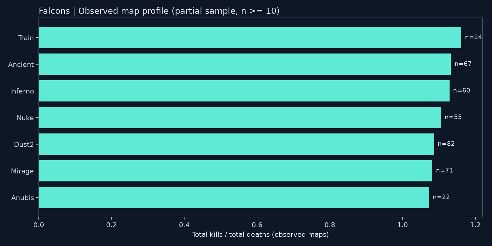
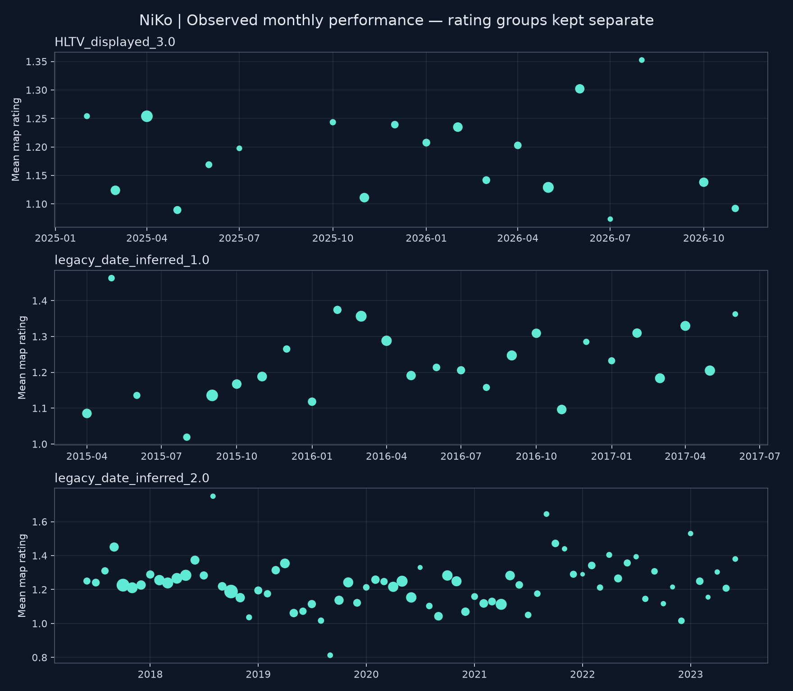

# NiKo Career Analysis · v1.0.0

快照核验日期：2026-11-10。统计单位为地图，非 BO3/BO5 系列赛。

## 主要发现

1. **同来源 CS2 样本**：G2 的总 K/D 为 1.148、平均 ADR 为 82.4（195 张）；Falcons 为 1.106 和 79.6（347 张）。两个样本属于不同时间、对手和赛制构成，不能据此断言转会导致表现变化。
2. **地图表现**：在至少 20 张 Falcons 观察地图的组中，Train 的总 K/D 最高，为 1.161（n=24）。这是描述性排序，样本量不平衡，不能解释为地图间显著差异。
3. **赢图与输图**：下表展示 Falcons 样本内的同场表现关联。Rating 仅计算有记录的子样本，不用同场信息包装赛前预测。

## v1 研究范围

共 2,030 张已接受地图，日期为 2015-04-17 至 2026-11-04；Falcons 381 张，G2 CS2 195 张。研究生涯阶段、地图、稳定性及胜负关联。
v1 是固定、部分覆盖的可复现研究快照。排名、赛事阶段、角色和武器数据不足，留作后续版本；不生成这些维度的结论。

## CS2 同来源对比

|战队|日期范围|地图|总 K/D|平均 ADR|ADR 有效样本|
|---|---|---:|---:|---:|---:|
|Falcons|2025-01-15 — 2026-11-04|347|1.106|79.6|347|
|G2|2023-11-30 — 2024-12-14|195|1.148|82.4|195|

此表只使用 ektarr v10 的已接受地图，避免将缺失 ADR 的网页样本混入同来源对比。提供商未提供 Rating，G2 CS2 Rating 保持缺失。

## Falcons：地图表现

|地图|地图数|总 K/D|平均 ADR|ADR 有效样本|胜率|
|---|---:|---:|---:|---:|---:|
|Train|24|1.161|84.3|21|50.0%|
|Ancient|67|1.133|79.6|59|67.2%|
|Inferno|60|1.129|80.4|58|48.3%|
|Nuke|55|1.106|80.8|50|61.8%|
|Dust2|82|1.087|78.6|76|59.8%|
|Mirage|71|1.082|79.1|65|60.6%|
|Anubis|22|1.073|75.3|18|63.6%|

## Falcons：胜负关联与波动

|地图结果|地图数|总 K/D|平均 Rating|Rating 有效样本|Rating 标准差|
|---|---:|---:|---:|---:|---:|
|loss|155|0.846|0.976|111|0.307|
|win|226|1.347|1.333|154|0.386|

标准差描述观察值的离散程度，不是跨时代的稳定性排名。Rating 的缺失机制可能影响子样本表现，不能假设有 Rating 的地图代表所有地图。

## 生涯阶段与统计口径

|战队|游戏|Rating 组|地图|Rating 有效样本|平均 Rating|总 K/D|
|---|---|---|---:|---:|---:|---:|
|FaZe|CSGO|legacy_date_inferred_1.0|75|75|1.245|1.219|
|FaZe|CSGO|legacy_date_inferred_2.0|724|724|1.226|1.205|
|Falcons|CS2|HLTV_displayed_3.0|265|265|1.184|1.083|
|Falcons|CS2|no_rating_provided|116|0|未提供|1.165|
|G2|CS2|no_rating_provided|195|0|未提供|1.148|
|G2|CSGO|legacy_date_inferred_2.0|283|283|1.229|1.176|
|mousesports|CSGO|legacy_date_inferred_1.0|372|372|1.217|1.171|

月度图按 Rating 口径分面，点大小表示有效 Rating 样本数；不连接缺失月份。旧版本标签由历史代码按日期推断，尚不能视为逐条核验的官方方法版本。CS:GO 与 CS2 的回合规则不同，跨游戏对比也需谨慎。

## 数据质量与合并决定

- 旧历史来源已通过三个原始 CSV 的 SHA-256 与重新下载的原始档案比对确认。
- 提供商 ID 26 通过全名和国家识别为 Nikola Kovač，排除了 ID 153 的另一位 niko；不混用提供商 ID 和 HLTV ID。
- 231 张地图在日期、队伍、对手、地图、K/D 和比分上匹配后补充网页 Rating。
- 1 个同日地图指标冲突隔离；10 条日期歧义的旧网页观察移出分析，不重复计算，不猜测日期。
- 所有决策见 [合并审计](cs2_reconciliation.csv)，各月样本量见 [覆盖日历](coverage_calendar.csv)。零表示没有载入观察值，不表示选手没有比赛。

## 指标定义与限制

- K/D = 有完整击杀和死亡记录的总击杀 / 总死亡；不是地图 K/D 的平均。总死亡为零时缺失。
- Rating 和 ADR 为地图等权均值，各自排除缺失值并报告有效样本数；不是按回合加权的官方汇总。多种非缺失 Rating 口径混合时不计算均值。
- 胜率仅对 win/loss 计算。看板和 CSV 给出 95% Wilson 区间作为描述参考；同系列地图相关，不能将其视为严格独立样本推断。
- 2021–2023 补充层较稀疏，2023 年过渡期以及其他来源遗漏尚未补齐。日期跨度不等于完整覆盖。
- 缺少对照选手、角色和历史排名，不能从本研究推断长期顶尖或转会影响的因果原因。

## 复现与来源

`python -m tools.build_portfolio` 离线重建本报告、CSV、图表、SQLite 与看板。输入是 `data/processed/niko_maps.csv`，输入哈希见 [快照清单](manifest.json)。
来源详情见 [来源审计](../docs/sources.md)；许可与署名见 [DATA_LICENSES](../DATA_LICENSES.md)。未持续监控或定时采集。
